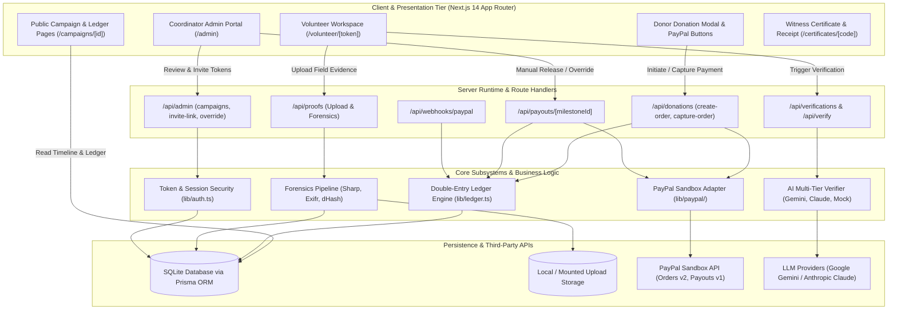

# Sakkhi (সাক্ষী) System Architecture

This document describes the technical architecture, security boundaries, money rules, and data flows of the Sakkhi platform as implemented in the final codebase.

---

## 1. High-Level System Architecture

Sakkhi links grassroots community funds, disaster relief initiatives, and public donations directly to tamper-verified receipts, photographs, and cryptographic witness proofs.

---

## 2. End-to-End System Flows

### Flow 1: Escrow Inflow (Donor → PayPal → Ledger)
1. **Pledge Initiation**: Donor selects an amount in BDT (e.g. ৳1,000) on `/campaigns/[id]`.
2. **Order Creation (`POST /api/donations/create-order`)**:
   - Server converts BDT poisha to USD cents at fixed rate ($1\text{ USD} = 120\text{ BDT}$).
   - Calls PayPal Orders API `v2/checkout/orders` with `intent: "CAPTURE"`.
   - Returns PayPal `orderId` to the client SDK button.
3. **Approval & Capture (`POST /api/donations/capture-order`)**:
   - Donor approves transaction in the PayPal modal.
   - Server calls PayPal `v2/checkout/orders/{id}/capture`.
   - Inside an isolated database transaction (`prisma.$transaction`):
     - Creates `Donation` row with status `COMPLETED`.
     - Credits campaign escrow: `campaign.totalDonated += amountPoisha`.
     - Appends an entry to the double-entry `LedgerEntry` table.
     - Logs an immutable `AuditLog` row.
     - Returns a unique receipt code (e.g. `SKH-20261028-0042`).

### Flow 2: Evidence Submission & Forensic Extraction
1. **Volunteer Access**: Field volunteer accesses `/volunteer/[token]` using a cryptographically signed, 7-day JWT invite link issued by the coordinator.
2. **File Upload (`POST /api/proofs`)**:
   - Checks file count (1-6 images) and magic bytes (validates JPEG, PNG, WebP via binary signatures).
   - Sharp resizes images to max 1600px dimension and strips metadata risk vectors.
   - Computes:
     - Cryptographic SHA-256 hash.
     - Perceptual difference hash (`dHash`, 64-bit gradient).
     - Sharpness score (Laplacian variance to flag blurry images).
   - Exifr parses EXIF/GPS/IPTC metadata (timestamp, latitude, longitude, camera model).
   - Saves optimized files to `UPLOAD_DIR` and persists `MediaFile` records.

### Flow 3: AI Forensic Verification Pipeline
1. **Deterministic Pre-Checks (`runPreChecks`)**:
   - **Duplicate Detection**: Queries database for identical SHA-256 hash or perceptual `dHash` (Hamming distance $\le 5$) across other milestones. If found, rejects submission instantly.
   - **Quality Check**: Flags low sharpness scores that obscure fine print.
2. **AI Multimodal Analysis**:
   - Selected provider (Gemini 1.5 Flash, Claude 3.5 Sonnet, or Mock) processes photos with strict prompt engineering.
   - Model extracts invoice numbers, vendor, line items, dates, and total amount.
   - Checks image evidence against milestone checklist.
   - Generates warm, 2-4 sentence donor-facing human summary.
3. **Deterministic Post-Checks (`applyDeterministicPostChecks`)**:
   - **Budget Tolerance Rule**: Extracted receipt total must be within $\pm 10\%$ of milestone budget.
   - **Timestamp Sanity Rule**: Capture timestamp must not precede campaign creation.
   - **Confidence Threshold**: If confidence $< 75\%$ or red flags exist, sets `needsHumanReview = true`.

### Flow 4: Milestone Payout Execution (PayPal Payouts API)
1. **Disbursement Trigger (`POST /api/payouts/[milestoneId]`)**:
   - Triggered automatically on clean verification approval, or manually by coordinator upon reviewing flagged submissions.
2. **Disbursement Invariants (Inside Database Transaction)**:
   - Milestone must be in `APPROVED` state.
   - Campaign must have sufficient unreserved balance:
     $$\text{availableBalance} = \text{totalDonated} - \text{totalRefunded} - \text{totalReserved} - \text{totalReleased} \ge \text{targetAmount}$$
   - No existing payout record may exist for this milestone.
   - If flagged, coordinator must have provided an override reason.
3. **PayPal Execution (`lib/paypal/payouts.ts`)**:
   - Converts milestone target poisha to USD cents.
   - Calls `v1/payments/payouts` with deterministic idempotency keys:
     - `sender_batch_id = batch-<milestoneId>`
     - `sender_item_id = item-<milestoneId>`
   - On success:
     - Creates `Payout` row with PayPal batch ID and item ID.
     - Debits available balance and credits `totalReleased`.
     - Writes `LedgerEntry` and `AuditLog`.
     - Marks milestone `PAID` with timestamp.

### Flow 5: Asynchronous Webhook Reconciliation
1. **Signature Verification (`POST /api/webhooks/paypal`)**:
   - PayPal webhook signature validated using PayPal verification endpoint.
2. **Event Processing**:
   - `PAYMENT.CAPTURE.COMPLETED`: Idempotent confirmation of donor payment.
   - `PAYMENT.CAPTURE.REFUNDED`: Reverses escrow balance if donor receives refund.
   - `PAYMENT.PAYOUTS-ITEM.SUCCEEDED`: Confirms final volunteer delivery.
   - `PAYMENT.PAYOUTS-ITEM.FAILED` / `RETURNED` / `UNCLAIMED`: Reverses released funds back into unreserved campaign balance and flags milestone for coordinator review.

---

## 3. Money Rules & Ledger Architecture

### 3.1 Integer Poisha Storage
All monetary amounts are represented as integers in the smallest currency unit:
- **BDT**: Stored in **Poisha** ($1\text{ BDT} = 100\text{ poisha}$).
- **USD**: Stored in **Cents** ($1\text{ USD} = 100\text{ cents}$).
- **Conversion Rate**: $1\text{ USD} = 120\text{ BDT}$ ($1\text{ poisha} \approx 0.008333\text{ cents}$).

### 3.2 Five Core Mathematical Ledger Invariants
1. **Conservation of Funds**:
   $$\text{Current Balance} = \text{totalDonated} - \text{totalRefunded} - \text{totalReleased}$$
2. **Non-Negative Escrow**: Available balance can never drop below zero. Any debit that would breach zero throws an unhandled exception and rolls back the transaction.
3. **Idempotency Guarantee**: Every mutating operation accepts a unique `idempotencyKey`. Repeated calls return the original result without re-executing ledger mutations.
4. **Permanent Audit Log**: Ledger entries cannot be updated or deleted; corrective actions are recorded as offsetting entries.
5. **Proportional Refundability**: If a milestone is rejected permanently, donors can receive proportional refunds from remaining escrow balance.

---

## 4. Security & Edge-Case Architecture

| Vulnerability / Edge Case | Architectural Defense | Implementation Location |
| :--- | :--- | :--- |
| **Double Disbursement** | Database unique constraint + PayPal `sender_batch_id` | [`lib/paypal/payouts.ts`](../lib/paypal/payouts.ts) |
| **Image Tampering / ELA** | Perceptual dHash + SHA-256 + Laplacian sharpness | [`lib/forensics.ts`](../lib/forensics.ts) |
| **Prompt Injection via Receipts** | Text in images treated strictly as untrusted data | [`lib/ai/prompts.ts`](../lib/ai/prompts.ts) |
| **Fake or Inflated Receipts** | Code-enforced 10% budget boundary check | [`lib/ai/deterministic.ts`](../lib/ai/deterministic.ts) |
| **Cross-Site Request Forgery (CSRF)**| SameSite cookies + Origin/Referer verification | [`lib/csrf.ts`](../lib/csrf.ts) |
| **File Upload Exploits** | Magic bytes sniffing, sharp re-encoding, isolated dir | [`app/api/proofs/route.ts`](../app/api/proofs/route.ts) |
| **Denial of Service / Flooding** | In-memory sliding-window rate limiting | [`lib/rateLimit.ts`](../lib/rateLimit.ts) |
| **Secret Leakage to Client** | Strict server-only env validation via Zod | [`lib/env.ts`](../lib/env.ts) |
